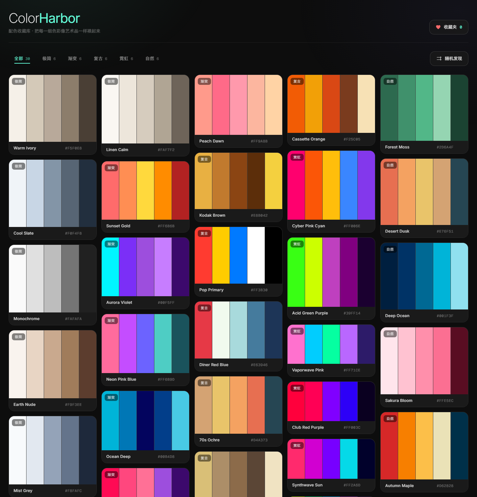
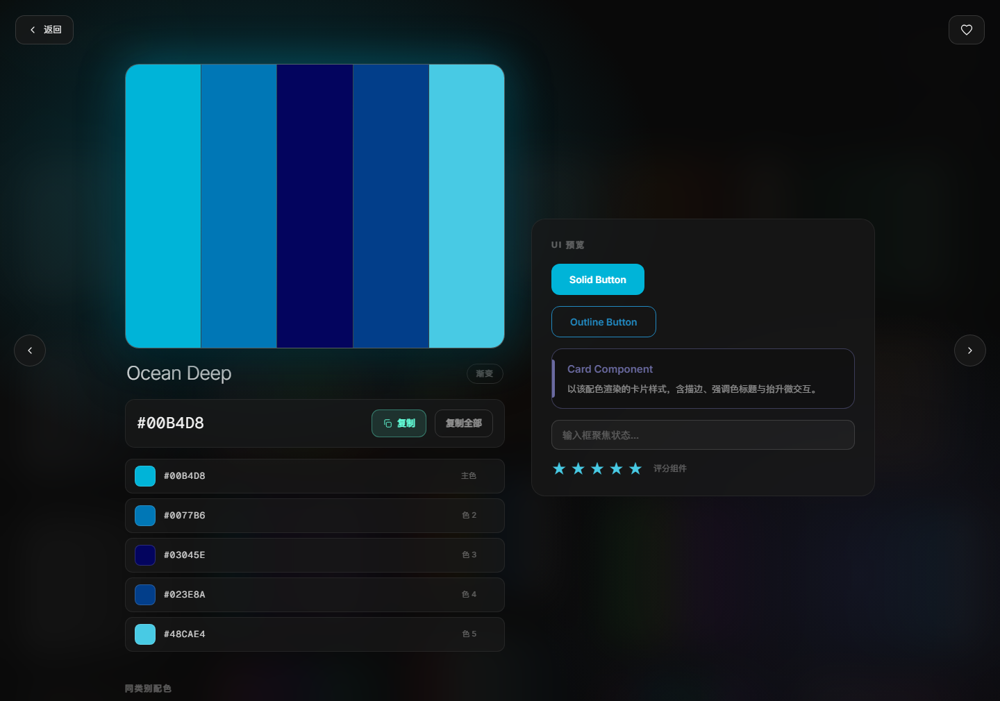

# ColorHarbor · 配色收藏库

> 暗色画廊里，每一组配色都被像艺术品一样裱了起来。

## 这是什么

ColorHarbor 是一个**纯前端、单文件**的配色收藏库。它把 30 组精心搭配的 5 色配色方案陈列在一面近黑的 Masonry 墙上，让「找配色 / 存配色 / 用配色」这三件事在一个页面里完成。

- 面向谁：设计师、前端工程师，以及任何需要给作品定色调的人。
- 解决什么：配色灵感散落在截图、收藏夹、备忘里——这里把它们集中成可浏览、可收藏、可复制的画廊。
- 设计基调：**暗色画廊**。近黑背景 `#0D0D0D` 把色彩衬成主角，半透明深灰 `#1A1A1A` 卡片、极细白边、霓虹青 `#64FFDA` 做交互反馈。

## 效果

| 首屏画廊 | 详情态 |
| --- | --- |
|  |  |

## 功能

**首屏**
- 顶部一行分类过滤标签：`全部 / 极简 / 渐变 / 复古 / 霓虹 / 自然`，带实时数量统计。
- 「随机发现」按钮：全场色块先抖动散开，再落定并打开一组随机配色。
- Masonry 色块网格：每块高度由 id 哈希生成，错落且稳定；hover 放大并带上**该配色自身颜色**的柔光外发光。
- 每个色块右下角有收藏爱心，左上角是类别角标。
- 页头右侧是 **收藏夹抽屉** 入口，带实时计数。

**详情态**（点击任意色块进入）
- 左侧：放大的五色色板（每条色可单独点击复制，hover 显示 hex）、配色名、主色 hex + 「复制 / 复制全部」、五色色值列表（点击即复制）。
- 右侧：**UI 预览** —— 实心按钮、描边按钮、卡片、输入框、评分组件，全部用当前配色实时渲染。
- 底部：同类别配色缩略图，一键跳转。
- 左右方向键 / 两侧箭头可在同类别配色间切换，`Esc` 返回。

**通用**
- 收藏持久化在 `localStorage`，抽屉里可单条移除或一键清空。
- 所有色值一键复制，带 Toast 反馈与色点提示。
- 响应式：5 → 4 → 3 → 2 列自适应；支持键盘操作、焦点可见、`prefers-reduced-motion`。

## 使用方式

1. 双击 `index.html` 直接在浏览器打开（零依赖、零构建）。
2. 点分类标签筛选灵感，或点「随机发现」交给运气。
3. 点色块右下角爱心收藏；点色块本身进入详情态看 UI 预览。
4. 在详情态点任意色值即可复制到剪贴板。

> 提示：`file://` 下剪贴板可能被浏览器限制，代码里已内置 `execCommand` 兜底。若仍失败，可用 `python -m http.server 8000` 以 HTTP 方式打开。

## 技术要点

- **单文件三合一**：样式、结构、30 组数据与全部交互都在 `index.html` 内，方便分发与二次修改。
- **数据驱动渲染**：`PALETTES` 是唯一数据源，改配色只需改数组。
- **对比度护栏**：`idealText()` 根据亮度自动决定按钮上是黑字还是白字；`readable()` 把过暗的色值按比例向白提亮，保证在深色面板上依旧可读，同时尽量保住色相（色块本身仍显示真实色值）。
- **Masonry**：CSS 多列布局 + `break-inside: avoid`，高度由 id 哈希预生成，过滤重渲染时不会跳动。
- **稳定入场动画**：`animation-fill-mode: backwards` 而非 `both`，避免结束帧的 `transform` 钉死导致 hover 放大失效。
- **无障碍**：语义化结构与 ARIA（`role="grid"` / `tablist` / `dialog` / `aria-pressed`），完整键盘可达，尊重减少动效偏好。
